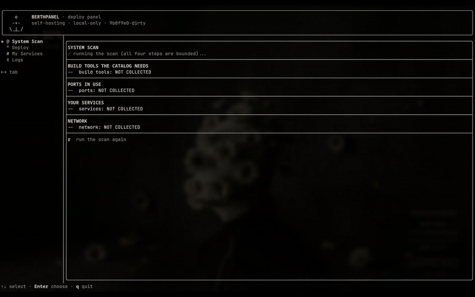

<div align="center">
  
</div>

<div align="center">
  <p>
    Paste a public GitHub URL, review the draft recipe it detects, fix
    anything it guessed wrong, and deploy to a hardened systemd <b>user</b>
    unit. Every deploy gets a sandboxed build and an assigned loopback port.
    No root, no daemon, allowlisted egress, <code>net.log</code> transparency,
    and journaled cleanup of interrupted deploys.
  </p>
  <p>
    <b>Status: alpha.</b> See <a href="#known-limitations-alpha">Known limitations</a> —
    in particular, the source must be a public <code>github.com</code> repository,
    toolchains are not auto-provisioned, and a detected <code>start_cmd</code> must be verified.
  </p>
  <p>
    
    
    
    
  </p>
</div>

<div align="center">
  
</div>

## What it does

- **Bring your own, or start from a small starter set.** Paste a public GitHub
  URL and let the wizard resolve the pin, clone, detect the stack and draft a
  recipe you review before anything is stored. A small, frozen starter catalog
  (Memos, Filebrowser, Gitea, Uptime Kuma) ships alongside it — it is a
  convenience, not the product.
- **Fix a wrong guess.** A detected `start_cmd` is an assumption; correct the
  user recipe with `berthpanel __recipe-edit` or `E` in the panel.
- **Sandboxed builds.** Builds run under `systemd-run --user` with a
  blast-radius-reducing sandbox — never as a trusted step (see
  [Trust model](#trust-model)).
- **Hardened user units.** Each service becomes a `berthpanel-<name>` systemd
  **user** unit on an assigned port, with `memory_max`/`tasks_max`.
- **Honest egress.** Every outbound request passes a compile-time host
  allowlist and is appended to `net.log`. There is no telemetry.
- **No daemon, no root.** One binary. Nothing needs Docker, and nothing
  needs `sudo` at runtime.

<div align="center">
  
</div>

## Paste a URL, get a unit running

<p align="center">
  
</p>

Paste a GitHub URL → the wizard resolves the commit, detects the build, and
shows a draft → confirm → the panel clones, builds in the sandbox, writes the
unit and registers the service. The stages stream from `deploy.log`.

<div align="center">
  
</div>

## How it compares

| | berthpanel | Umbrel | CasaOS | Coolify | YunoHost |
|---|---|---|---|---|---|
| Needs a Docker daemon | **No** | Yes | Yes | Yes | No |
| Allowlisted egress + `net.log` | **Yes** | No | No | No | No |
| Isolation per app | systemd **user** unit + sandbox | container | container | container | nginx + system units |
| Ships as | one binary | appliance OS | shell install | shell install | ISO / script |
| Root at runtime | **No** | via daemon | via daemon | via daemon | root services |
| Documented min. RAM | see [note](#a-note-on-memory) | project docs | project docs | 2 GB ([docs](https://coolify.io/docs/get-started/installation)) | project docs |

The comparison is about architecture, not features. Docker-based panels
(Umbrel, CasaOS, Coolify) are excellent for a beefier box and a large app
catalog; berthpanel trades catalog breadth and multi-container stacks for a
footprint that fits a **1 GB VPS**, no root, and a request log you can actually
read.

### A note on memory

berthpanel's panel is a single binary of about 5.4 MiB and runs **no
daemon**; its services are systemd user units. A Docker-based panel additionally
runs the Docker daemon and one container per app — Coolify, for instance,
documents a **2 GB RAM** minimum
([coolify.io/docs](https://coolify.io/docs/get-started/installation)). The other
projects in the table do not publish a single comparable figure here, so none is
quoted; check their own docs. Numbers are only listed when they come from the
project's own documentation.

<div align="center">
  
</div>

## Trust model

Read this as what it is: a set of concrete, checkable properties, with the
limits stated plainly.

- **Allowlisted egress.** Every outbound request is checked against a
  compile-time host allowlist (`kAllowedEndpoints`), per hop, with no redirect
  following, and appended to `net.log`. See the exact list with
  `berthpanel --show-endpoints`.
- **The sandbox is a blast-radius reducer, not a trust boundary.** Builds run
  as *your* user. The sandbox narrows what a hostile build can reach; it does
  not make it safe. Say it, mean it.
- **Reproducible, signed releases.** The release artifact is byte-identical
  between a local build and CI (`make repro` / the CI gate), and the release's
  `SHA256SUMS` is signed with minisign. The signing key is never in CI; CI only
  verifies. Every release carries its Corresponding Source (GPL-3.0).
- **No telemetry.** Nothing is reported anywhere. `net.log` is local, and it is
  the whole story of what the panel asked for.

Trusted release public key:

```
fingerprint: 136DAF31D72588E4
```

<div align="center">
  
</div>

## Platform: Linux + systemd `--user`

This is a deliberate boundary, not an unfinished port. berthpanel's entire
no-root model is systemd **user** units; on a host without a user systemd
manager there is no honest way to keep the promise, so it does not pretend to.

- **Supported:** Linux with systemd and a user session.
- **Non-goal:** macOS, Windows, and NAS appliances whose "systemd" is a vendor
  shell or an appliance UI. They are not a TODO list.
- **Web from your phone:** `berthpanel __serve-status --listen 127.0.0.1:0`
  serves a read-only loopback page; front it with Tailscale for remote access.
  A full web UI is a different product.

<div align="center">
  
</div>

## Install

`install.sh` is the single installer **and** uninstaller. It is verify-first
and fails closed: it checks the release's `SHA256SUMS` against a minisign
signature before installing anything, and verifies every artifact's checksum.
It never runs `sudo` and never installs a system package. `--allow-checksum-only`
is the explicit opt-out of the signature step.

The quick path is a one-liner that runs the installer straight from the repo's
default branch:

```sh
curl -fsSL https://raw.githubusercontent.com/Est-Void/berthpanel/main/install.sh | sh
```

Be honest about what that trusts: the **script** arrives over TLS from GitHub,
so piping it to `sh` trusts TLS and GitHub for the script itself — it is not
independently verified. The release artifacts it then installs **are** verified
(signed `SHA256SUMS` plus per-artifact checksums), so a compromised mirror or a
tampered binary is still caught. To verify the script too, download it, check
its own detached signature, and only then run it. Or do the whole thing by hand:

```sh
# Verify first, then run — never pipe an unverified script straight to sh.
minisign -Vm SHA256SUMS -p release.pub
sha256sum --check --strict SHA256SUMS
sh install.sh --source . --pub release.pub
```

Useful seams: `--dry-run` resolves and verifies everything but installs nothing;
`--version V` fetches a specific release; and `BERTHPANEL_RELEASE_URL` points at
a different artifact base. When no local artifacts are present, the installer
fetches the pinned release (never a floating `latest`) over HTTPS.

Uninstall is the same script: it stops and removes only `berthpanel-`-prefixed
user units and the binary, and leaves your data under
`~/.local/share/berthpanel` alone.

```sh
sh install.sh --uninstall
```

From source:

```sh
make            # debug build   -> build/debug/berthpanel
make release    # release build -> build/release/berthpanel
```

Run `berthpanel --selftest` after installing to confirm your user manager works.

<div align="center">
  
</div>

## Known limitations (alpha)

- **`github.com` only.** The source front door accepts an https GitHub URL and
  nothing else; other forges are not supported.
- **Public repositories only.** Pins are resolved without a token, so a private
  repository cannot be deployed.
- **Toolchains are limited to `bun`, `pnpm`, `go` and `python3`** and must
  already be on `PATH`; the alpha does not auto-provision a toolchain into the
  sandbox.
- **A detected `start_cmd` is a heuristic.** A service can deploy and still
  never answer; verify it and correct it with `__recipe-edit` (or `E`).
- **The builtin catalog is frozen at wave 1** (Memos, Filebrowser, Gitea,
  Uptime Kuma). Add your own project as a user recipe instead.
- **Single-unit services only.** Multi-process stacks are out of scope for v1.
- **Uninstall does not purge data.** It stops and unregisters a service but
  leaves its data directory under `~/.local/share/berthpanel` for you to delete.

<div align="center">
  
</div>

## Where it fits

A tiny VPS — the 1 GB box where Docker panels do not live — or a home server
you would rather not hand to a daemon. If you want a big app catalog and
multi-container stacks, a Docker-based panel is the better tool; berthpanel is
for the small, honest, no-root end of the range.

<div align="center">
  
</div>

## Ports, TLS and the no-root model

berthpanel runs unprivileged: the panel, every deploy and every managed unit are
systemd **user** units. That has one honest consequence — a user process cannot
bind ports below 1024 on a default host, so terminating TLS on 80/443 needs one
of:

- a one-time host setup by you: `sudo sysctl -w net.ipv4.ip_unprivileged_port_start=0`
  (persist it under `/etc/sysctl.d/`). berthpanel never sets this for you, and it
  lowers the port floor for every unprivileged process on the host, not only for
  berthpanel — hence the explicit opt-in; or
- keeping the reverse proxy on a high port and forwarding 80/443 to it from a
  root-owned system proxy or your router.

There is no mode that is both no-root and able to bind 80/443 without one of
those. The panel does not pretend otherwise.

<div align="center">
  
</div>

## Reach a service only over your tailnet

If you do not want to expose a service publicly at all, keep it on loopback and
let Tailscale carry it: `tailscale serve --bg http://127.0.0.1:<port>` fronts
the service on your node's MagicDNS name over your WireGuard mesh, with a
Tailscale-issued certificate and no inbound port, no public DNS and no ACME
challenge. Only devices in your tailnet (per its ACLs) can reach it. berthpanel
never invokes Tailscale, never talks to it and adds it to no allowlist — it is a
third-party control plane you opt into, and the panel only keeps the service
bound to loopback as the recipes always do.

<div align="center">
  
</div>

## License

GPL-3.0 (see [`LICENSE`](LICENSE)). Every release offers its **Corresponding
Source**: a `berthpanel-<version>-src.tar.gz` built from the tagged git tree
ships alongside the binary, and its checksum is covered by the same signed
`SHA256SUMS`.
